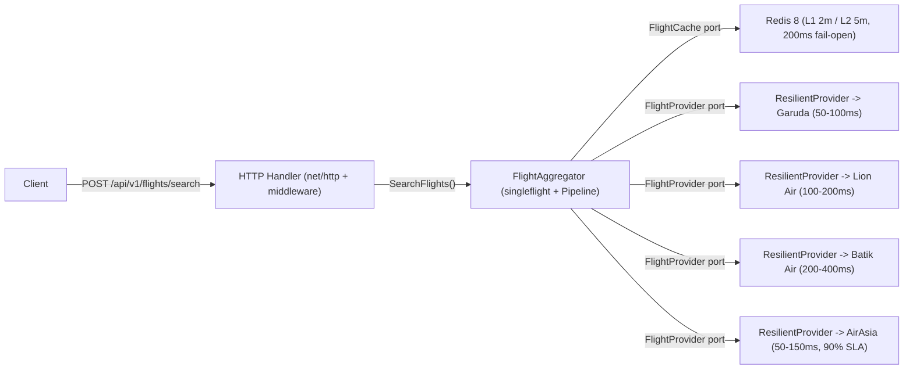

# BookCabin Flight Search & Aggregation System

A Clean Architecture Go backend that concurrently aggregates, normalizes, validates, filters, compares, ranks, and caches flight search results across multiple Indonesian airline providers (`Garuda Indonesia`, `Lion Air`, `Batik Air`, and `AirAsia`).

## Architecture & Key Design Choices



*Dependency rule: `internal/domain` has zero internal imports; `internal/usecase` imports only `domain` and `platform`, keeping carrier adapters and Redis swappable behind interfaces. See [docs/architecture.md](docs/architecture.md) for the request sequence diagram and detailed trade-offs.*

### Key Design Decisions

| Decision | Choice | Why & Trade-off |
| :--- | :--- | :--- |
| **Clean Architecture** | `domain` ports + outer adapters | Isolates business rules from airline wire formats and Redis; adding a carrier needs one adapter + registration. |
| **Partial-Failure Isolation** | `context.WithoutCancel` per provider (`10s` cap) | One slow or failing airline never cancels healthy peers; only total failure (`0` succeeded) returns HTTP `503`. |
| **Provider Resilience** | Token bucket + timeout + jittered backoff | Rate limiter runs *before every attempt* to prevent retry RPS bursts; permanent auth/contract errors fail fast via `IsNonRetryableError`. |
| **Two-Level Validation** | Adapter contract check + `Flight.Validate()` | Normalizers absorb per-carrier quirks (offsets, segments, units); domain invariants drop invalid records and return `400` on bad requests. |
| **Two-Tier Cache + Fail-Open** | `L1` (`2m`) + `L2` (`5m`) + `singleflight.DoChan` | `L1` serves filter/sort tweaks at ~`0ms`; partial failures skip `L1` write-through while healthy carriers stay warm in `L2`; Redis (`200ms` timeout) fails open. |
| **Pipeline Ordering** | `ComparePrices -> ScoreBestValue -> Filter -> Sort` | Price comparisons and value scores keep the route-wide baseline even when filtering to one airline or price band. |
| **Best-Value Scoring** | Weighted min-max (`[0.0, 1.0]`) | Balances Price (`50%`), Duration (`30%`), Stops (`15%`), and Amenities (`5%`), using a `0.5` neutral fallback on zero spread. |

### Provider Policies & Adapter Quirks

| Airline Provider | Latency & SLA | Timeout | Retries | Rate Limit (RPS / Burst) | Adapter Quirks Handled |
| :--- | :--- | :--- | :--- | :--- | :--- |
| **Garuda Indonesia** | `50-100ms` (100%) | `500ms` | `1` | `50 / 10` | Multi-segment layovers (`GA315`), carrier-supplied baggage/amenities |
| **Lion Air** | `100-200ms` (100%) | `600ms` | `1` | `40 / 10` | Naive datetimes resolved via `WIB`/`WITA`/`WIT` timezone offsets |
| **Batik Air** | `200-400ms` (100%) | `800ms` | `1` | `30 / 8` | Numeric `+0700` offsets & cabin code `"Y"` -> `"economy"` |
| **AirAsia** | `50-150ms` (**90% SLA**) | `500ms` | `2` | `50 / 10` | Fractional hours (`4.33h` -> `260m`), baggage strings, transient retries |

---

## Quickstart

### Option 1: Docker Compose (API + Redis 8, Recommended)

```bash
docker compose up --build -d
curl http://localhost:8080/health
curl http://localhost:8080/ping
```

Stop containers cleanly when finished:

```bash
docker compose down
```

### Option 2: Local Go (Fail-Open if Redis is Offline)

Copy `.env.example` to `.env` if overriding defaults:

```bash
go run ./cmd/api
```

### Environment Variables

| Variable | Default | Description |
| :--- | :--- | :--- |
| `PORT` | `8080` | HTTP server listen port |
| `LOG_LEVEL` | `info` | `debug`, `info`, `warn`, `error` |
| `READ_TIMEOUT` | `5s` | HTTP server read timeout |
| `WRITE_TIMEOUT` | `10s` | HTTP server write timeout |
| `SHUTDOWN_TIMEOUT` | `10s` | Graceful shutdown deadline |
| `REDIS_ADDR` | `localhost:6379` | Redis address (`redis:6379` in Compose; fails open if down) |
| `CACHE_BASE_TTL` | `2m` | L1 base search cache TTL |
| `CACHE_PROVIDER_TTL` | `5m` | L2 per-provider search cache TTL |

---

## API Usage & `curl` Examples

### Endpoints

| Method | Path | Description |
| :--- | :--- | :--- |
| `GET` | `/ping` | Lightweight liveness check (`{"status":"pong"}`) |
| `GET` | `/health` | Readiness/health check with UTC timestamp |
| `POST` | `/api/v1/flights/search` | Concurrent flight aggregation, filtering, price comparison, ranking & sorting |

### 1. Basic Search (PDF Contract Default)

```bash
curl -s -X POST http://localhost:8080/api/v1/flights/search \
  -H "Content-Type: application/json" \
  -d '{
    "origin": "CGK",
    "destination": "DPS",
    "departureDate": "2025-12-15",
    "returnDate": null,
    "passengers": 1,
    "cabinClass": "economy"
  }' | jq .
```

### 2. Filtered Search + Best-Value Ranking

Supports optional `sortBy` (`price_asc`, `price_desc`, `duration_asc`, `duration_desc`, `departure_asc`, `departure_desc`, `arrival_asc`, `arrival_desc`, `best_value`) and `filters` (`min_price`, `max_price`, `stops`, `max_stops`, `max_duration_minutes`, `airlines`, `departure_window`, `arrival_window`):

```bash
curl -s -X POST http://localhost:8080/api/v1/flights/search \
  -H "Content-Type: application/json" \
  -d '{
    "origin": "CGK",
    "destination": "DPS",
    "departureDate": "2025-12-15",
    "passengers": 1,
    "cabinClass": "economy",
    "sortBy": "best_value",
    "filters": {
      "max_stops": 0,
      "max_price": 1500000,
      "airlines": ["Garuda Indonesia", "QZ"],
      "departure_window": { "start": "06:00", "end": "12:00" },
      "max_duration_minutes": 150
    }
  }' | jq '{metadata, flights: [.flights[] | {flight_number, provider, price, best_value_score, price_comparison}]}'
```

*(Note: After Example 1 populates L1 in Redis, Example 2 serves from warm cache with `metadata.cache_hit: true` even with new `filters` and `sortBy` values.)*

### 3. Postman Collection

Import [docs/postman/bookcabin-flight-aggregator.postman_collection.json](docs/postman/bookcabin-flight-aggregator.postman_collection.json) into Postman (set `baseUrl` if not using `http://localhost:8080`). It includes pre-configured requests and Postman test assertions for `/ping`, `/health`, default `price_asc`, `best_value`, `duration_asc`, multi-predicate filters, empty `[]` array serialization, and `400` validation errors.

---

## Performance, Complexity & Benchmarks

### Algorithmic Complexity ($N$ = aggregated flights, $P$ = providers)

| Stage | Time Complexity | Extra Space | Notes |
| :--- | :--- | :--- | :--- |
| Concurrent Scatter-Gather | $O(\max_p \text{latency}_p)$ | $O(N)$ | Parallel goroutines bounded by slow provider (`Batik` 200–400ms) |
| `FilterFlights` | $O(N)$ | $O(N)$ | Single pass with $O(1)$ hash-set checks for `stops` and `airlines` |
| `ComparePrices` | $O(N)$ | $O(G)$ | Two linear passes grouped by `(origin, destination, cabin_class)` markets |
| `ScoreBestValue` | $O(N)$ | $O(1)$ | Two linear passes for min-max bounds and weighted composite score |
| `SortFlights` | $O(N \log N)$ | $O(1)$ auxiliary | In-place `slices.SortStableFunc` with deterministic tie-breakers |
| Warm L1 Cache Read | $O(N)$ unmarshal + pipeline | $O(N)$ | Eliminates upstream network I/O; observed `0ms` HTTP latency in Docker E2E |

### Measured Go Benchmarks (`go test -bench=. -benchmem -run=^$ ./internal/usecase/...`)

Measured on Windows `amd64` (`AMD Ryzen 5 2600 Six-Core Processor`, Go 1.26):

| Benchmark | Iterations | Latency (`ns/op`) | Memory (`B/op`) | Allocations (`allocs/op`) |
| :--- | :--- | :--- | :--- | :--- |
| `BenchmarkFilterFlights_100` | `75,657` | `17,183 ns` (~17.2 µs) | `41,448 B` | `32` |
| `BenchmarkFilterFlights_1000` | `6,790` | `157,350 ns` (~157.4 µs) | `373,448 B` | `302` |
| `BenchmarkComparePrices_1000` | `1,453` | `802,496 ns` (~802.5 µs) | `176,416 B` | `9,003` |
| `BenchmarkScoreBestValue_1000` | `23,498` | `51,590 ns` (~51.6 µs) | `8,000 B` | `1,000` |
| `BenchmarkSortFlights_1000` | `1,036` | `1,037,477 ns` (~1.04 ms) | `0 B` | `0` |
| `BenchmarkSearchFlights_ColdScatterGather` | `8,780` | `131,007 ns` (~131.0 µs) | `66,841 B` | `320` |
| `BenchmarkSearchFlights_WarmL1Cache` | `4,648` | `240,063 ns` (~240.1 µs) | `33,095 B` | `364` |

*(Compare `~240 µs` warm L1 execution against `200–400 ms` simulated upstream airline API delays—roughly a **1,000x** speedup on cache hits.)*

---

## Project Structure

```text
├── cmd/api/main.go                    # Composition root (DI wiring, tzdata, graceful shutdown)
├── internal/
│   ├── domain/                        # Entities, Validate(), FlightProvider & FlightCache ports, errors
│   ├── platform/                      # Config, slog logger, timeutil (WIB/WITA/WIT), IDR currency
│   ├── provider/                      # Garuda, Lion, Batik, AirAsia adapters + ResilientProvider
│   ├── repository/
│   │   ├── redis/                     # Redis 8 go-redis/v9 Client (200ms fail-open timeout)
│   │   └── noop/                      # No-op FlightCache fallback
│   ├── usecase/                       # FlightAggregator, cache keys, filter, comparator, ranker, sorter
│   └── handler/http/                  # Chi-free stdlib net/http mux, DTOs, trace_id & recovery middleware
├── docs/                              # setup.md, infrastructure.md, architecture.md, milestone progress
├── Dockerfile
├── docker-compose.yml                 # api + redis:8-alpine
└── Makefile
```

## Verification & Testing

```bash
make test              # Run all unit tests with -race
make lint              # Run go vet + golangci-lint (if installed)
make check             # Run gofmt check, lint, and unit tests
make test-integration  # Run Redis integration tests (-tags=integration, requires live Redis)
go test -bench=. -benchmem -run=^$ ./internal/usecase/...  # Run usecase microbenchmarks
```

## Documentation

- [AGENTS.md](AGENTS.md) — Repository invariants & contributor workflow
- [docs/setup.md](docs/setup.md) — Local setup & environment variables
- [docs/infrastructure.md](docs/infrastructure.md) — Container topology & Redis 8 cache keys
- [docs/architecture.md](docs/architecture.md) — Layer rules & resilience decisions
- [docs/postman/bookcabin-flight-aggregator.postman_collection.json](docs/postman/bookcabin-flight-aggregator.postman_collection.json) — Postman v2.1 collection with endpoint examples & test scripts
- [docs/tasks/1-bootstrap-mvp/progress.md](docs/tasks/1-bootstrap-mvp/progress.md) — Commit-by-commit milestone tracker & follow-up roadmap
