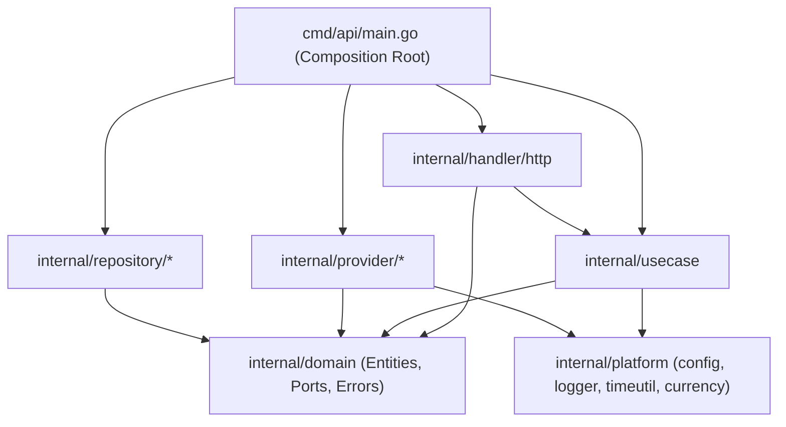

# System Architecture & Design Decisions

## 1. Layer Boundaries (Dependency Inversion)



- **`internal/domain`**: Zero internal imports. Owns entities (`Flight`, `SearchCriteria`), `Validate()` invariants, sentinel errors, and port interfaces (`FlightProvider`, `FlightCache`).
- **`internal/usecase`**: Imports only `domain` and `platform`. Orchestrates fan-out, caching, filtering, price comparison, best-value scoring, and sorting.
- **`internal/provider/*` & `internal/repository/*`**: Concrete airline normalizers, `ResilientProvider`, and Redis/no-op caches wired in `cmd/api/main.go`.

## 2. Request, Cache & Partial-Failure Flow

```mermaid
sequenceDiagram
    participant C as Client
    participant H as HTTP Handler
    participant A as FlightAggregator
    participant R as Redis (L1 / L2)
    participant P as ResilientProvider (x4)

    C->>H: POST /api/v1/flights/search
    H->>A: SearchFlights(ctx, criteria, opts)
    A->>A: Validate criteria, filters, sortBy
    A->>R: GET L1 flight_search:{route}
    alt L1 Cache Hit
        R-->>A: Cached base flights (filter/sort applied live)
    else L1 Cache Miss
        A->>A: singleflight.DoChan(baseKey) with 10s isolated ctx
        par Concurrent per-provider fetch
            A->>R: GET L2 provider:{name}:{route}
            alt L2 Miss
                A->>P: Rate limit -> Timeout -> Backoff retry
                P-->>A: Normalized []domain.Flight or error
                opt Provider succeeded
                    A->>R: SET L2 (5m TTL)
                end
            end
        end
        alt All providers failed
            A-->>H: 503 Service Unavailable
        else All providers succeeded
            A->>R: SET L1 (2m TTL)
        else Partial failure
            Note over A,R: Skip L1 write-through; L2 retains healthy providers
        end
    end
    A->>A: ComparePrices -> ScoreBestValue -> FilterFlights -> SortFlights
    A-->>H: SearchResult
    H-->>C: 200 OK JSON
```

## 3. Detailed Design Rationale & Trade-offs

- **Pre-Filter Comparison & Scoring (`ComparePrices -> ScoreBestValue -> FilterFlights`)**: Running `ComparePrices` before `FilterFlights` prevents single-airline or narrow price filters from wiping out `price_comparison` or skewing `cheapest_provider`. Running `ScoreBestValue` pre-filter keeps scores market-relative instead of inflating a lone surviving flight to `1.0`.
- **Two-Level Price Comparison**: `ComparePrices` matches exact normalized flight numbers and identical schedules across providers first (codeshare awareness), falling back to `(origin, destination, cabin_class)` market baselines when carriers operate disjoint flight numbers.
- **`singleflight.DoChan` + `context.WithoutCancel`**: Decouples the shared upstream fetch (`10s` bounded timeout) from the first caller's deadline while each waiter `select`s on `<-ctx.Done()`. A fast-timing-out leader cannot abort coalesced followers, yet impatient callers still exit immediately.
- **Per-Attempt Rate Limiting & Fast-Fail Error Classification**: `ResilientProvider` acquires a token-bucket permit before *every* physical attempt so transient retries cannot amplify upstream RPS. `IsNonRetryableError` stops retries immediately on permanent auth/contract/payload errors (`ErrProviderUnauthorized`, `ErrProviderInvalidResponse`, `ErrProviderContract`).
- **Fail-Open Redis & Embedded Timezones**: Redis commands enforce a `200ms` operation timeout and fail open to live provider fan-out if Redis is unreachable. Binaries embed `time/tzdata` so `Asia/Jakarta` (`WIB`), `Asia/Makassar` (`WITA`), and `Asia/Jayapura` (`WIT`) resolve accurately inside minimal Alpine containers.
